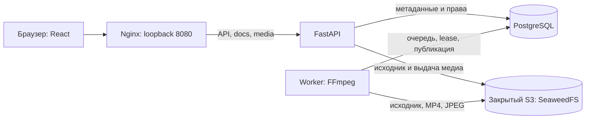

# Video-service

Тестовый аналог YouTube: загрузка и обработка видео, просмотр, взаимодействия
и модерация. Исходное [задание работодателя](docs/original-assignment.md) —
основной источник требований; [внутренняя матрица](docs/requirements.md)
уточняет критерии и допущения проекта.

## Возможности

- **Зрителю:** лента с превью, поиск по названию, MP4-плеер с перемоткой,
  счётчик просмотров, лайки видео и комментариев, комментарии и ответы.
- **Автору:** регистрация и вход, собственный канал, загрузка с прогрессом,
  статусы обработки в Studio, редактирование метаданных, public/private,
  выдача и отзыв доступа конкретным пользователям, удаление своего видео.
- **Подписчикам:** каналы авторов, подписки и плейлисты с порядком видео.
- **Модератору и администратору:** жалобы, скрытие/восстановление видео,
  журнал решений; admin назначает и снимает роль moderator.
  Роли не дают обхода приватного доступа.

<a id="локальный-запуск"></a>

## Быстрый запуск

На **чистой Ubuntu 24.04 LTS amd64**, из корня распакованного репозитория:

```bash
sudo bash scripts/deploy.sh --demo
```

Нужны sudo/root, интернет и свободный порт 8080. Практический ориентир для демо:
2 CPU, 4 ГиБ RAM, минимум 8 ГиБ свободного места на файловых системах репозитория
и Docker, желательно 15 ГиБ. Это рекомендация, а не измеренный минимальный размер VM.
Python, Node.js, PostgreSQL и FFmpeg заранее на хосте не требуются.
Установщик при необходимости устанавливает Engine/Compose из официального
apt-репозитория Docker, создаёт защищённую конфигурацию, собирает приложение,
применяет миграции, инициализирует закрытый S3 и запускает демо-наполнение.
Он не удаляет конфликтующие пакеты и не перезаписывает нестандартные Docker apt sources.

| Что открыть | Адрес |
| --- | --- |
| Приложение | <http://localhost:8080> |
| Swagger | <http://localhost:8080/docs> |
| OpenAPI | <http://localhost:8080/openapi.json> |
| Liveness / readiness | <http://localhost:8080/health/live> / <http://localhost:8080/health/ready> |

**Опубликован только Nginx на `127.0.0.1:8080`.** PostgreSQL, S3 и служебные
интерфейсы не доступны снаружи. В браузере используйте `localhost`, согласованный
с `APP_ORIGIN`. Для удалённой VM нужен SSH-туннель; публичный HTTPS в поставку не входит.

Демо-учётные данные сгенерированы в **`.local/demo/credentials.json` (0600)**.
Скрипт выводит путь, без паролей. Откройте файл в приватном терминале:

```bash
sudo less .local/demo/credentials.json
```

Не публикуйте этот файл, `.env`, S3-конфигурацию или полный вывод Compose config.
Seed создаёт пять аккаунтов трёх ролей, два наполненных канала, шесть коротких
синтетических видео (public/private/hidden), private grant, плейлист, подписки,
лайки, комментарии и рассмотренные жалобы с аудитом. Видео проходят настоящий
HTTP upload → очередь → FFmpeg. Весь seed ограничен 900 секундами.
Без `--demo` устанавливается приложение без демонстрационных аккаунтов.

**Повтор команды сохраняет секреты, записи и медиа.** Не удаляйте `.env`,
`.local/demo/state.json` и volumes, не переименовывайте действующий Compose project
`video-service`. При потерянной конфигурации и существующих volumes установщик
отказывает вместо генерации несовместимых секретов. Seed продолжает незавершённые
шаги, не сбрасывает пароли/роли и не создаёт заново удалённые завершённые ресурсы.
Повреждённый журнал seed восстанавливайте из той же резервной копии.
Если все public demo-видео скрыты, удалены или обработка failed, проверка откажет,
сохранив данные: исследуйте Studio/worker, не очищайте стенд ради повтора.

Установка на чистой Ubuntu подтверждена прежним испытанием T08 от **17 ноября
2026 года**: Ubuntu 24.04.5 amd64, QEMU/KVM, **4 vCPU, 8192 МиБ RAM, диск 24 ГиБ**,
около **20,6 ГиБ свободно** перед установкой. Проверены установка Docker самим
скриптом, повторный запуск, reboot, сохранность данных и браузерное воспроизведение.
Проверялся коммит `a0ad6545f66977fae822362c136659094fb260ab`;
это не новый прогон текущего дерева. [Условия и результаты T08](docs/deployment-review.md#t08-clean-vm).

## Стек и компоненты

Python 3.13, FastAPI, Pydantic 2, SQLAlchemy 2/psycopg 3/Alembic,
PostgreSQL 17; React/TypeScript/Vite, React Router и CSS; Nginx;
SeaweedFS 4.53 с закрытым S3 API; FFprobe/FFmpeg; Docker Compose.
Python/npm-зависимости закреплены lock-файлами, базовые образы — digest.
Engine/Compose при первой установке берутся из stable apt Docker, системные
пакеты — из репозиториев дистрибутива: побитовая идентичность сборок разных дат не заявляется.



Пять постоянных сервисов: `web`, `api`, `worker`, `db`, `storage`.
Одноразовые `migrate` и `storage-init` готовят схему и bucket до старта API/worker.
Подробности и схема данных — в [архитектуре текущей реализации](docs/architecture.md).

## Основной сценарий проверки

1. Откройте `/register`, создайте собственный аккаунт (пароль 12–128 символов).
   После регистрации вход выполнен, канал создан автоматически.
2. Перейдите в `/upload`, выберите собственный короткий MP4/WebM, задайте название,
   описание и public. Лимиты: 500 МиБ, 1–600 секунд, до 3840×2160 и 60 fps.
3. Отправьте файл и дождитесь готовности в `/studio`:
   `queued → processing → ready`. 100% отправки означает завершение передачи
   из браузера, обработка показывается отдельным статусом.
4. Откройте `/watch/:id`, запустите плеер, проверьте звук (если он есть в исходнике)
   и перемотку. Для ролика от 10 секунд просмотр засчитывается после 10 секунд
   воспроизведения, для короткого — после половины длительности;
   повтор того же зрителя в течение 24 часов не увеличивает итог.
5. Поставьте лайк и оставьте комментарий; обновите страницу и проверьте сохранение.
   Видео также должно находиться в ленте, канале и поиске по названию.

Дополнительно: в Studio переключите видео в private, выдайте доступ по точному
username другого зарегистрированного пользователя и проверьте его в отдельном
браузерном профиле. После отзыва следующий запрос metadata/media получает 404;
сама ссылка разрешения не даёт. Демо-аккаунты позволяют отдельно проверить
`/moderation` и `/admin`. Работу удаления проверяйте только на своём тестовом видео:
операция необратима, S3 очищается worker после закрытия доступа.

## Автоматизированные проверки

| Набор | Как запустить |
| --- | --- |
| Скрипты развёртывания | `python3 -m unittest discover -s scripts/tests -v` (Python 3.10+) |
| Обычный pytest без интеграций | Из `backend/` с dev-зависимостями: `env -u RUN_INTEGRATION pytest -p no:cacheprovider` |
| Полный pytest + PostgreSQL/S3, Ruff, TypeScript/build | [Готовый блок с изоляцией и cleanup](docs/development.md#temporary-checks) |
| HTTP smoke работающего стенда | `python3 scripts/check_http.py --base-url http://localhost:8080` |
| Браузерный основной сценарий | `VIDEO_FIXTURE=/tmp/test-video.mp4 node tests/e2e/social.cjs`; [подготовка и другие E2E](docs/development.md#браузерные-сценарии) |

После установки через sudo скриптам чтения защищённой конфигурации также нужен
sudo. Обычный pytest пропускает интеграции без `RUN_INTEGRATION=1`.
Полный прогон выполняйте в уникальном временном Compose project: скрипт
`scripts/run_checks.py` подставляет отдельные тестовые credentials, а оболочка
с `trap` убирает зависимости. Один `run --rm` этого не делает.
Миграционные откаты, удаление и fault injection не выполняются на основном стенде.

## Ключевые инженерные решения

- **Доступ:** серверные сессии, Argon2id, HttpOnly/SameSite cookies, проверка Origin
  и CSRF при изменениях. Роли и владелец читаются с сервера. Единая политика
  проверяет ready/visible, отсутствие удаления и public либо владельца/grant.
- **Медиа:** закрытый S3, без публичных ACL и presigned URL. MP4/JPEG выдаются
  через API с авторизацией каждого GET/HEAD/Range и `private, no-store`.
  Отзыв запрещает следующие запросы; уже полученные байты отозвать невозможно.
- **Обработка:** потоковая загрузка с проверкой фактического размера;
  FFprobe проверяет содержимое, FFmpeg создаёт H.264/AAC MP4 до 1280×720/30 fps
  и JPEG. Worker работает non-root, с таймаутами и лимитами 2 CPU, `mem_limit: 2g`,
  128 PID; subprocess не наследует секреты.
- **Устойчивость:** очередь PostgreSQL, lease 60 секунд с продлением каждые 15,
  максимум три попытки, отдельные ключи результатов каждой попытки и атомарная
  публикация MP4/превью в БД. Cleanup удаляет технические сироты только после
  проверки ссылок; удаления владельца имеют отдельную устойчивую очередь.
- **Данные:** named volumes сохраняют PostgreSQL и весь `/data` SeaweedFS;
  нужны согласованные backup БД, медиа и секретов. Readiness проверяет БД,
  миграцию, S3 и свежий heartbeat worker, включая пустую очередь.

## Подтверждённые испытания и ограничения

Результаты ниже взяты из сохранённых протоколов; **при этой редактуре тесты,
сборки и развёртывание не выполнялись**.

| Источник | Результат прежнего прогона |
| --- | --- |
| [T08, 17 ноября](docs/deployment-review.md#t08-clean-vm) | Чистая Ubuntu: установка одной командой, demo, повтор, reboot и сохранность — PASS |
| [Финальные технические исправления, 18 ноября](docs/final-technical-fixes-review.md) | Обычный pytest: 67 passed, 249 skipped; полный интеграционный: 316 passed, 0 skipped; Ruff и TypeScript/build — PASS |
| [Тот же финальный протокол](docs/final-technical-fixes-review.md) | Chromium: восстановление watch/auth, просмотры 0→1→2 с дедупликацией, auth state и Studio cursor после удаления — PASS; HTTP smoke и worker health — PASS |

Целевые наборы входят в полный прогон, их числа не суммируются.
Осталось предупреждение Starlette/httpx. Поздний финальный протокол подтверждает
исправления ошибок восстановления watch/auth и pytest skip; прежние описания
этих дефектов в исторических отчётах не означают текущий отказ.

Ограничения: один API и один FFmpeg worker на одном хосте, без HLS/адаптивных
качеств, CDN и browser resumable upload. Масштабирование worker требует
координации cleanup; контейнер FFmpeg не является полной песочницей.
Защита просмотров ограничивает повторы аккаунта/гостевого cookie, не является
антифродом. После terminal 4xx, TTL или исчерпания повторов учёт ждёт нового
жизненного цикла плеера; вкладки не пересоздают сессии бесконечно.
Полная нагрузочная методика N03 и минимальные ресурсы не измерены,
публичное HTTPS и аварийный restore на чистой VM не подтверждены.
Финальный технический протокол сохраняет PARTIAL для V02/S08/D06/D07/N02/N05
и NOT VERIFIED для N03; эта редактура не пересчитывает его статусы.
Оригинальные AI-диалоги и обвязка включены в [ai-evidence/](ai-evidence/README.md).
Готовность ZIP с полным Git-репозиторием требует отдельной проверки.

## ИИ и агентная обвязка

Контекст разработки собран в отдельной папке [ai-evidence/](ai-evidence/README.md):

- [Сессии Codex](ai-evidence/codex/sessions/) и
  [архивные сессии](ai-evidence/codex/archived_sessions/) — 74 исходных JSONL-файла
  за 14–18 ноября 2026 года, включая сессии подагентов; около 113 МиБ.
- [Настройки](ai-evidence/codex/agent-config/config.toml) и
  [общие инструкции агента](ai-evidence/codex/agent-config/AGENTS.md) — снимки
  окружения разработки. Правила проекта находятся в корневом [AGENTS.md](AGENTS.md).
- [Снимки системных skills](ai-evidence/codex/available-system-skills/) — пять
  доступных наборов инструкций; наличие снимка не подтверждает использование.
- [Манифест](ai-evidence/codex/manifest.json) содержит размеры и SHA-256 всех
  журналов; [опись исходной сдачи](ai-evidence/submission-inventory.json)
  сохраняет сведения о комплекте для коммита `6949035`.

Материалы перенесены из `Video-service-submission-final-6949035/` без изменения
содержимого. Дублирующая копия проекта из этой папки удалена. Экспорт веб-диалогов
ChatGPT в исходном комплекте отсутствует. Журналы не нужны для запуска приложения
и находятся вне Docker build context backend/frontend.

## Документация и эксплуатация

| Документ | Назначение |
| --- | --- |
| [Исходное задание](docs/original-assignment.md) | Требования работодателя, приоритет над внутренними критериями |
| [Требования и допущения](docs/requirements.md) | Внутренняя матрица F/V/S/D/N/T и принятые трактовки |
| [Архитектура](docs/architecture.md) | Компоненты, модель БД, pipeline, авторизация и компромиссы |
| [Разработка и эксплуатация](docs/development.md) | [Обновление](docs/development.md#единственный-основной-стенд-и-обновление), [backup/restore](docs/development.md#резервная-копия-и-восстановление), изоляция тестов и команды |
| [Развёртывание](docs/deployment-review.md#t08-clean-vm) | Исторический протокол чистой Ubuntu и границы испытания |
| [Интеракции YouTube](docs/youtube-interactions.md) | Комментарии, ответы, удаление и просмотры |
| [Редизайн](docs/frontend-redesign.md) | Интерфейс и визуальные проверки |
| [Протоколы функций](docs/feed-interactions-review.md) | Лента/поиск; также [каналы/плейлисты](docs/channels-playlists-review.md), [модерация](docs/moderation-review.md), [стабилизация](docs/stabilization-review.md) |
| [Просмотры](docs/video-views-main-review.md), [финальные исправления](docs/final-technical-fixes-review.md) | Последовательные испытания 18 ноября; поздний протокол уточняет прежние ограничения |

При сбое начните с `sudo less .local/deploy.log`,
`sudo docker compose ps -a` и `sudo docker compose logs --tail 100 api worker storage`.
Readiness 503 требует проверки БД/S3/heartbeat, занятый порт или нехватка места —
исправления окружения. Не удаляйте volumes/медиа и не запускайте prune.
Подробные действия и сохранение данных — в
[troubleshooting](docs/development.md#диагностика-развёртывания).
