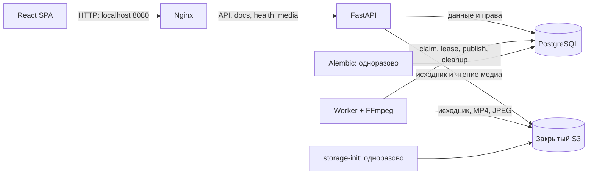
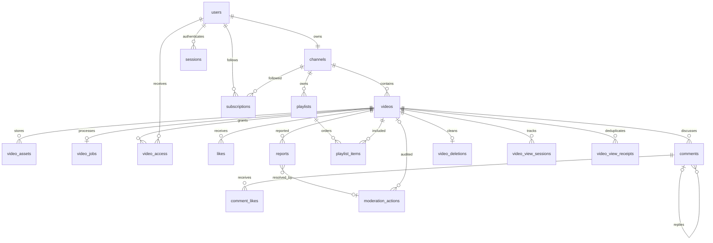
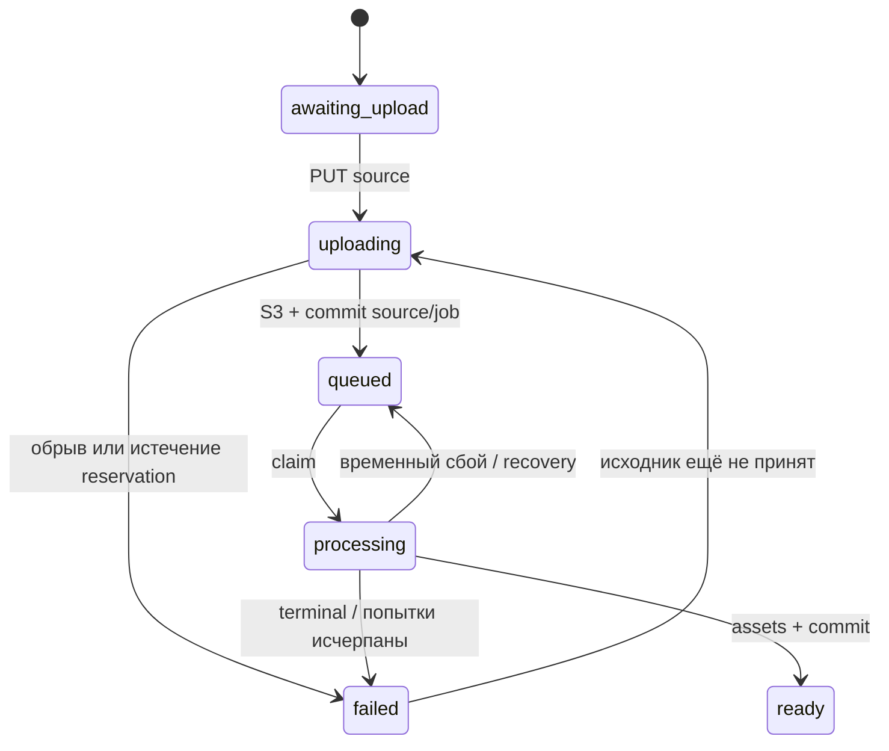

# Video-service: архитектура текущей реализации

Документ описывает реализацию в рабочем дереве на 18 ноября 2026 года
(as-built). Источники: [исходное задание](original-assignment.md),
[Compose](../compose.yaml), модели и [миграции](../backend/migrations/versions/).
[Внутренняя матрица требований](requirements.md) уточняет принятые допущения,
но не заменяет задание работодателя. Условия прежних испытаний и ограничения
доказательств собраны в [README](../README.md#подтверждённые-испытания-и-ограничения).

## Решения и границы компонентов

| Область | Реализация и причина выбора |
| --- | --- |
| Backend | Python 3.13, FastAPI, Pydantic 2, Uvicorn. Модульный монолит: общая предметная модель для HTTP, CLI и worker, без сетевых вызовов между внутренними модулями. |
| БД | PostgreSQL 17, синхронный SQLAlchemy 2, psycopg 3, Alembic. Транзакции, FK и ограничения защищают связи; обычные sync handlers выполняются в thread pool, блокирующий I/O загрузки вынесен из event loop. |
| Frontend | React, TypeScript, Vite, React Router, CSS. SPA, fetch для JSON, XHR для прогресса загрузки, нативный HTML5 video. Node.js 22 используется при сборке, SSR отсутствует. |
| Объектное хранилище | SeaweedFS 4.53, один `weed mini -dir=/data`, закрытый S3 через boto3. Single-node S3 выбран для простого развёртывания и отделён адаптером; MinIO не используется. Замена S3-сервера требует отдельной проверки совместимости и безопасности. |
| Обработка | Один отдельный worker из общего backend-образа, FFprobe/FFmpeg. Тяжёлая обработка переживает HTTP-запрос и не выполняется в FastAPI BackgroundTasks. |
| Очередь | PostgreSQL `video_jobs`, lease/retry. Запись исходника и задания фиксируется одной SQL-транзакцией; для масштаба демо отдельные Redis/RabbitMQ/Celery не нужны. |
| Вход | Nginx со сборкой SPA: один origin для приложения, API, Swagger и медиа. Браузер не получает доступ к S3 и его credentials. |
| Развёртывание | Docker Compose на одном Ubuntu-хосте, volumes, healthchecks, одноразовые migrate/storage-init. Зависимости закреплены lock-файлами, базовые образы — digest; системные apt-пакеты не заморожены побитно. |



`web`, `api`, `worker`, `db`, `storage` — пять постоянных сервисов.
`migrate` и `storage-init` должны завершиться успешно до API/worker.
Storage-init создаёт bucket и проверяет анонимный отказ; административные S3
credentials передаются ему, API/worker получают прикладные credentials.
Опциональный `seed` наполняет демо через HTTP и реальную очередь обработки.

Compose project по умолчанию — `video-service`. Только `web` публикует
`127.0.0.1:${WEB_PORT:-8080}:8080`. Nginx подключён к сетям `edge`/`app`, API —
к `app`/`data`, worker/БД/S3 — к `data`; `app` и `data` внутренние.
Профиль `checks` использует отдельную внутреннюю сеть `test-data`, tmpfs БД/S3
и отдельные credentials. Тестовый проект выбирается уникальным на каждый прогон.

### Маршрутизация Nginx

[Конфигурация](../frontend/nginx.conf) проксирует `/api`, `/docs`,
`/openapi.json` и `/health` в `api:8000`, без SPA fallback для этих путей.
`/assets/` выдаёт статические файлы либо 404; остальные пути используют
`index.html` для React Router. Docker DNS resolver позволяет переопределять
адрес API после пересоздания контейнера.

Для source upload отключены request/response buffering, лимит тела 500 MiB,
`client_body_timeout=900s`, proxy read/send timeout 950s. Остальной API имеет
лимит тела 16 KiB и отключённый proxy cache/buffering, включая media.
Nginx ограничивает login/register по IP до 5/3 запросов в минуту с burst=2,
отдаёт 429 при превышении. Публичный reverse proxy/TLS сюда не настроен.

### Организация исходников

```text
backend/app/
  main.py, api.py, health.py   # создание приложения, роутеры, readiness
  core/, db/                  # конфигурация, cursor, SQLAlchemy Session
  modules/
    auth/, admin/             # аккаунты, сессии, роли и аудит
    access/policy.py           # can_watch и SQL-фильтры доступа
    videos/                   # upload, media, feed, deletion, views
    interactions/             # лайки, комментарии, ответы
    channels/, playlists/, moderation/
  infrastructure/             # S3 и запуск FFprobe/FFmpeg
  worker/                     # очередь, lease, heartbeat, cleanup, удаления
  cli/                        # admin, seed, storage-init/probe, cleanup views
backend/migrations/versions/   # эволюция схемы
backend/tests/                # обычные и integration тесты
frontend/src/
  app/, pages/, features/, components/, api/, styles/
tests/e2e/                    # Chromium/Playwright сценарии
scripts/                      # deploy, конфигурация, checks и HTTP smoke
```

Роутеры отвечают за HTTP, зависимости сессии/Origin/CSRF и сериализацию;
services — за правила и транзакции, repositories — за запросы к БД.
Некоторые специализированные сервисы (views/deletion/playlists) содержат SQL
непосредственно; универсального repository или event bus нет. Канал моделируется
в auth, подписки — в playlists, HTTP плейлистов подключён в channels/router.
Worker и API разделяют код и долговечные данные, но не память, SQL Session и scratch.
Передача тела медиа выполняется после освобождения соединения БД. Длительные
S3 writers имеют отдельную advisory-lock транзакцию для координации удаления;
это исключение из коротких транзакций метаданных, без удержания Video row lock
на всё время S3 upload.

## Модель данных

Ниже — прикладные таблицы; `alembic_version` ведётся Alembic отдельно.
Одиночные основные PK — UUID, время — timezone-aware UTC.
Исключения: составные PK связей и строковый `worker_id`. Поля состояний
проверяются CHECK, не PostgreSQL enum. Таблица перечисляет ключевые поля,
а не заменяет DDL. Точные типы/индексы — в моделях и миграциях.

| Таблица | Данные, отношения и ограничения |
| --- | --- |
| `users` | email/username UNIQUE, password_hash, role (`user/moderator/admin`), created_at/updated_at. Email и hash исключены из публичных ответов. |
| `channels` | user_id UNIQUE FK → users, title, description, timestamps. Один канал автоматически создаётся при регистрации; адрес использует username. |
| `sessions` | user_id FK → users, token_hash UNIQUE, csrf_token, expires_at, created_at; индексы user_id/expires_at. Сырой session token в БД не сохраняется. |
| `videos` | channel_id FK → channels; title/description, visibility, status, moderation_state, duration_ms/width/height, published_at, deleted_at, views_count BIGINT CHECK ≥ 0; upload_token/expires_at, error_stage/code, timestamps. Владелец определяется через канал. |
| `video_assets` | video_id FK → videos, kind (`source/playback/thumbnail`), object_key UNIQUE, content_type, size_bytes > 0, sha256, created_at; UNIQUE(video_id, kind). |
| `video_jobs` | video_id UNIQUE FK → videos; status (`queued/running/succeeded/failed`), attempts 0–3, run_after, lease_token/expires_at, heartbeat_at, last_error_code, timestamps. Одна строка на видео, попытки обновляют её. |
| `video_access` | PK(video_id, user_id), FK → videos/users; granted_by FK → users, created_at. Выдаёт/отзывает только владелец. |
| `likes` | PK(video_id, user_id), FK → videos/users, created_at; идемпотентный PUT/DELETE. |
| `comments` | id, video_id FK → videos ON DELETE CASCADE, user_id FK → users, nullable parent_id, body 1–2000 символов с непробельным содержимым, created_at. Составной FK(parent_id, video_id) → comments(id, video_id) ON DELETE CASCADE, запрет parent_id=id. |
| `comment_likes` | PK(comment_id, user_id), FK → comments ON DELETE CASCADE и users; created_at. |
| `subscriptions` | PK(user_id, channel_id), FK → users/channels, created_at. Запрет self-subscription проверяет service. |
| `playlists` | channel_id FK → channels, title, description, timestamps. Плейлисты публичные, редактирование только владельцем. |
| `playlist_items` | PK(playlist_id, video_id), FK → playlists ON DELETE CASCADE и videos; position ≥ 0, created_at. UNIQUE(playlist_id, position) DEFERRABLE INITIALLY DEFERRED. |
| `reports` | video_id/reporter_id/reviewed_by FK, reason (`spam/copyright/abuse/other`), body, status (`open/dismissed/actioned`), review_note, resolved_action_id FK → moderation_actions, created_at/reviewed_at. UNIQUE(video_id, reporter_id); CHECK согласует статус с заполнением решения. |
| `moderation_actions` | actor_id FK → users, video_id или target_user_id FK, action (`hide/restore/set_role`), previous_value/new_value, reason, created_at. CHECK требует единственную подходящую цель. |
| `worker_heartbeats` | worker_id строковый PK (используется `main`), last_seen_at; readiness при пустой очереди. |
| `video_deletions` | video_id PK/FK → videos; status (`pending/retry/complete`), attempts ≥ 0, run_after, last_error_code, cleaned_at. Устойчивая очередь очистки постоянных tombstone. |
| `video_view_sessions` | PK(video_id, viewer_key), FK → videos ON DELETE CASCADE; session_id UNIQUE, position_ms/played_ms/sequence ≥ 0, rate 0.25–2, active/completed, updated_at/expires_at. |
| `video_view_receipts` | PK(video_id, viewer_key), FK → videos ON DELETE CASCADE; counted_at для скользящего окна дедупликации. |



Диаграмма показывает основные связи; прочие FK пользователей перечислены в таблице.
Основные индексы: public/ready/visible videos по published_at/id, видео канала
по channel_id/created_at/id, comments по video_id/parent_id/created_at/id,
очередь по status/run_after/created_at, reports по status/created_at/id,
очистка по run_after и expires_at/counted_at. Лайки и комментарии считаются
запросами, без дублирующих счётчиков; просмотры — отдельный сохранённый итог.

Миграции в [versions](../backend/migrations/versions/) последовательно добавляют
auth, audit, video pipeline, likes/comments, channels/playlists, reports,
ограничение resolution, replies/comment likes (`b7d2e8f91a60`),
deletions (`d4a6c2e91f08`), views (`f2c9a41d6e80`, текущий head исходников).
Upgrade с несовместимой историей жалоб и downgrade с потерей истории отказывают;
[эксплуатационные ограничения](development.md#администратор-и-миграционные-ограничения).

## Загрузка, обработка и публикация



`visibility` (`public/private`), `moderation_state` (`visible/hidden`) и
`deleted_at` независимы от статуса обработки. `published_at` устанавливается
при первом ready и не обновляется при смене visibility.

1. `POST /api/videos` создаёт черновик с серверным владельцем (private по умолчанию).
   XHR отправляет File как `application/octet-stream` в `PUT /api/videos/{id}/source`.
   Интерфейс отдельно показывает отправленные байты и queued/processing/ready.
2. API проверяет owner/Origin/CSRF, свободное место и состояние. Блокировки users
   и videos резервируют upload token на 15 минут; один пользователь может иметь
   одну активную загрузку. Семафор ограничивает единственный API двумя загрузками.
3. Тело читается потоково в `api_scratch`, фактический размер и SHA-256 считаются
   независимо от заголовков. Максимум 500 MiB, общий timeout 900 секунд,
   минимально свободное место scratch 2 GiB. Имя клиента не задаёт путь/ключ.
4. API пишет `sources/{video_id}/{upload_token}/original` в S3 и проверяет размер
   через HEAD. Пока token действителен и видео не удалено, одна SQL-транзакция
   создаёт source asset, video_jobs и queued, затем отвечает 202.
   Принятый source неизменяем: повторная отправка получает 409.
5. Потерянный ответ после commit проверяется через Studio. Если исходник не принят,
   отправку можно повторить в тот же черновик. Истёкшая reservation становится failed.
   Scratch очищается в finally; объект без SQL-ссылки оставляется для cleanup.
6. Worker выбирает задачу `FOR UPDATE SKIP LOCKED`, повышает attempts,
   создаёт lease и переводит видео в processing. До скачивания и кодирования
   транзакция claim закрыта. Размер/хеш скачанного source проверяются повторно.
7. FFprobe (timeout 30 секунд) проверяет самостоятельный MP4/MOV/Matroska/WebM,
   видеопоток, длительность 1–600 секунд, размеры до 3840×2160 с учётом поворота,
   fps до 60. MIME/расширение клиента не заменяют проверку содержимого.
8. FFmpeg создаёт H.264/AAC MP4: до 1280×720 без upscale, 30 fps, yuv420p,
   faststart, libx264 veryfast/crf=23, maxrate 2500k/bufsize 5000k,
   AAC 128k stereo при наличии аудио; без исходных метаданных/субтитров/attachments.
   JPEG-превью до 640×360. Выходной MP4 проверяется FFprobe.
9. MP4/JPEG записываются под `processed/{video_id}/{lease_token}/...`.
   После проверки объектов одна транзакция публикует оба assets, параметры,
   ready/published_at и job succeeded. Visibility/moderation_state сохраняются.
   Публикация повторно проверяет token и срок lease после ожидания блокировок.

FFmpeg вызывается без shell, с локальным входом, allowlist форматов и протоколов
`file,pipe`, без наследования секретов; timeout кодирования 20 минут.
Worker non-root, максимум два threads кодирования, лимиты Compose 2 CPU,
`mem_limit: 2g`, 128 PID, отдельный `worker_scratch`. Это ограничивает ресурсы,
но не является полной изоляцией от уязвимого декодера или локального чтения файлов.

### Lease, retry и cleanup

Lease — 60 секунд, продление каждые 15 секунд; heartbeat `main` обновляется
отдельным потоком также при пустой очереди. При потере lease отменяется обработка,
устаревшая попытка не публикуется. Recovery возвращает просроченную задачу в queued
при attempts < 3, иначе — failed. Временные ошибки повторяются с backoff 10/60
секунд, максимум три запуска; неподдерживаемый/повреждённый формат — terminal failure.

S3 и PostgreSQL не образуют распределённую транзакцию: безопасность публикации
дают неизменяемые ключи попыток, lease fencing и последующая очистка сирот.
Worker синхронно вызывает cleanup после завершения run_once, периодически раз
в час. Удаляются только распознанные технические объекты/незавершённые multipart
старше 24 часов без asset-ссылок и активного upload/lease token; при недоступной БД
очистка прекращается. Действительные source assets сохраняются.
API очищает только свой scratch, worker — свой; каталоги с активными token защищены.

**Один worker — эксплуатационный инвариант.** Проверка ссылки и S3 delete не атомарны
с публикацией. Нельзя добавлять worker или внешний S3 cleanup без координации:
текущая последовательность run_once → cleanup предотвращает эту гонку.

## Авторизация и выдача медиа

Пароли 12–128 символов, Argon2id. Серверные сессии выбраны ради немедленного
logout и актуальной роли без JWT. Случайный токен 256 бит хранится в cookie
`session_id`, в БД — SHA-256 токена; TTL 7 суток. Cookie HttpOnly, SameSite=Lax,
Path=/, Secure для HTTPS; локальный HTTP разрешён только для loopback.
Login создаёт новую сессию и удаляет прежнюю из cookie, logout удаляет текущую.
Роль читается из users при запросах, клиент не задаёт владельца или роль.

Изменения требуют `Origin == APP_ORIGIN` и `X-CSRF-Token` действующей сессии;
login/register требуют Origin и JSON, но ещё не имеют session CSRF.
`GET /api/auth/session` восстанавливает пользователя и CSRF; ответы auth — no-store.
Для гостевых событий просмотров действует Origin и серверный guest cookie,
для событий с действующей сессией дополнительно обязателен CSRF.

[Политика доступа](../backend/app/modules/access/policy.py) допускает просмотр,
если видео **не удалено, ready и visible**, а также public либо зритель — владелец
или имеет `video_access`. Она используется metadata/media/thumbnail,
интеракциями и событиями просмотров; SQL-эквивалент фильтрует плейлисты.
Публичные feed/search/channel показывают только public.

| Действие | Права |
| --- | --- |
| Читать public/ready/visible | Гость и все роли |
| Читать private/ready/visible | Только владелец или пользователь с grant, независимо от роли |
| Загружать, менять видео/grants, удалять | Вошедший владелец соответствующего ресурса |
| Лайки, комментарии, ответы, жалоба | Вошедший пользователь с доступом к видео |
| Скрыть/восстановить, рассмотреть жалобу, читать аудит | Moderator/admin |
| Назначить/снять moderator | Admin; API не создаёт admin и не меняет существующего admin |

Studio показывает владельцу свои draft/failed/private/hidden и ошибки обработки;
это не разрешает смотреть hidden. Служебная карточка жалобы доступна модератору
без grant, но не раскрывает private title/description/thumbnail/media.
Администратор создаётся [CLI](development.md#администратор-и-миграционные-ограничения).

Плеер получает `/api/videos/{id}/media`, превью — `/thumbnail`, без object key,
S3 credentials или presigned URL. Каждый GET/HEAD/Range заново проверяет доступ.
Недоступное/скрытое/удалённое видео даёт одинаковый 404. После revoke или
public → private следующий запрос запрещён; уже выданные байты отозвать невозможно.

GET поддерживает один byte range (включая suffix/open-ended): 206 при диапазоне,
200 без него, 416 с Content-Range при некорректном/множественном диапазоне.
HEAD игнорирует Range и возвращает полный размер без тела.
API проверяет S3 HEAD, читает GetObject порциями 256 KiB, закрывает S3 body
при отмене; отдаёт `private, no-store`, nosniff, корректные Content-Type/Length.
Исходник для чтения не публикуется, Nginx не кеширует медиапрокси.

## Каналы, плейлисты, взаимодействия и модерация

Лента и поиск по title используют параметризованный Unicode ILIKE с буквальными
`%`, `_`, `!` и `\`; q обрезается по краям, ограничен 200 символами.
Пагинация feed — keyset published_at/id DESC, comments/replies — created_at/id ASC.
Cursor содержит контекст списка, валидируется и не авторизует запрос.
Studio принимает UUID cursor собственного видео, включая удалённую tombstone,
чтобы удаление опорного элемента не обрывало список. Чужая tombstone даёт 404.
Плейлист использует position: если anchor удалён/стал недоступен, возвращает 422
с предложением перезагрузить список. Не все курсоры независимы от опорной строки.

Подписка — идемпотентная связь пользователя и чужого канала. Плейлист содержит
только видео владельца, порядок меняется под блокировкой плейлиста, запрос должен
содержать полный текущий набор ID без повторов. Публичное чтение фильтрует
недоступные видео до pagination, не выдаёт позиции скрытых элементов.
Studio позволяет редактировать и неготовые собственные элементы.

Лайки видео/комментариев — идемпотентные PUT/DELETE с составными PK.
Комментарии сохраняются как текст 1–2000 символов с непробельным содержимым,
React не интерпретирует HTML. Ответ на ответ связывается с корневым комментарием;
один уровень вложенности обеспечивает service, составной FK запрещает parent
из другого видео. Video row lock сериализует запись с revoke/visibility/deletion.

Жалоба требует can_watch, допускается одна на пару video/reporter.
Решения dismissed/actioned требуют reviewer/note/time; actioned ссылается на
moderation_action. Рассмотренную жалобу нельзя переоткрыть/пересмотреть (409).
Скрытие, audit и решение по выбранной жалобе фиксируются атомарно;
восстановление не меняет прежние private grants. Изменения роли также атомарны
с аудитом, повтор того же состояния не создаёт фиктивной записи.
API редактирования/удаления журнала отсутствует.

## Удаление владельцем

`DELETE /api/videos/{id}` фиксирует `deleted_at` и `video_deletions` в одной
транзакции, затем отвечает 204. Повтор владельца — 204, чужое/неизвестное видео —
404 для всех ролей. Удаление необратимо, tombstone сохраняется навсегда;
восстановление модератором её не отменяет.

Сразу очищаются title/description и технические поля, grants, лайки, комментарии
(ответы/лайки каскадно), элементы плейлистов, view sessions/receipts.
Текст жалоб/review_note и reasons действий обезличивается; идентичности действий,
участники, переходы и связи решений остаются для аудита. Сохранённый videos.views_count
не сбрасывается, но tombstone исключена из чтения и публичных списков.

Worker отдельно удаляет только объекты/parts `sources/{id}/` и `processed/{id}/`
проверенного формата, проверяет ссылки других видео, затем убирает asset/job строки.
Advisory lock координирует cleanup с ещё работающими storage writers, а tombstone
запрещает позднюю публикацию. Ошибки S3 повторяются с экспоненциальной задержкой
до часа; после complete ежечасная сверка ловит поздние записи при обрыве БД.
Это очередь удаления владельцем, отличная от суточной очистки технических сирот.
Доступ закрыт сразу после commit, физическое удаление медиа выполняется позже.

## Учёт просмотров

`videos.views_count` — долговечный итог, GET metadata/media и Range его не меняют.
Плеер отправляет start/progress через POST; сервер проверяет can_watch, позицию,
sequence, скорость и прошедшее серверное время. Порог: 10 секунд для видео
от 10 секунд, иначе половина длительности с округлением миллисекунд вверх.
Seek, пауза, скачок позиции или интервал без событий более 8 секунд не дают
накопить неподтверждённое время.

Viewer key — SHA-256 идентичности аккаунта либо случайного HttpOnly guest cookie.
IP не является идентификатором. PK(video_id, viewer_key) в receipts и Video lock
обеспечивают один зачёт за скользящие 24 часа, атомарно с инкрементом.
Сессия просмотра имеет TTL один час; новый start заменяет прежнюю вкладку этого
зрителя/видео, вытесненная вкладка получает 404. Очистка expired sessions/receipts
не уменьшает исторический итог; её вызывает worker и CLI cleanup_views.

Frontend ждёт подтверждения состояния auth/CSRF; временные отказы views допускают
три восстановления с 1/2/4s и timeout 8s. Старые неопределённые интервалы отбрасываются,
дедупликация переживает потерю ответа после commit. Terminal 4xx, TTL и исчерпание
попыток останавливают учёт до нового жизненного цикла, не создавая борьбу вкладок.
Это ограничение антинакрутки по аккаунту/cookie, не защита от автоматизированного
зрителя, который меняет идентичность. Позднее восстановление auth/watch описано в
[финальном протоколе](final-technical-fixes-review.md), уточняющем
[предыдущую проверку просмотров](video-views-main-review.md).

## API, наблюдаемость и эксплуатационные ограничения

Актуальный контракт отдаётся в `/docs` и `/openapi.json`:
`/api/auth`, `/api/videos`, `/api/me/videos`, `/api/channels`, `/api/me/channel`,
`/api/me/subscriptions`, `/api/playlists`, `/api/me/playlists/{id}`,
`/api/moderation`, `/api/admin`. В videos входят source/access/media/thumbnail,
like/comments/replies/comment likes/reports/views и DELETE владельца.
HTTP/validation ошибки содержат code/message/request_id, ответы — X-Request-ID;
полностью структурированные коррелированные логи N05 не реализованы.

Liveness проверяет жизнь API; readiness — подключение к БД, наличие записи
в `alembic_version`, авторизованный S3 и heartbeat worker не старше 45 секунд.
Точное совпадение версии с head readiness не проверяет; upgrade выполняет migrate.
Неудача зависимости — 503.
`postgres_data` хранит БД, `media_data` — весь `/data` SeaweedFS с метаданными filer,
`api_scratch`/`worker_scratch` — раздельные технические volumes.
Секреты и state seed хранятся вне Git; обновление сохраняет их и основные volumes.
API/worker используют один образ и обновляются согласованно; `restart` не доставляет
новые исходники. [Порядок обновления, backup/restore и troubleshooting](development.md).

Компромиссы текущего масштаба: один API/worker/S3-хост, один вариант MP4 без
адаптивных качеств/HLS/CDN, поиск без pg_trgm/GIN, без browser resumable upload,
без полноценной песочницы FFmpeg и мониторингового кластера. Пределы входа
проверяются, но полная матрица V02/S08 остаётся частично испытанной.
Минимальные ресурсы, нагрузочные ориентиры N03 и публичный HTTPS не подтверждены;
согласованное аварийное восстановление на чистой VM не проверено.

Критичное поведение покрывается `backend/tests/integration/` на реальных
PostgreSQL/S3 и `tests/e2e/` в Chromium: grants/revoke, роли, Range,
lease/cleanup/faults, миграции, комментарии, удаление и просмотры.
Обычный pytest пропускает интеграции. Команды — в [development](development.md#temporary-checks),
прежние результаты — в [README](../README.md#подтверждённые-испытания-и-ограничения).
Состав сдачи с Git/оригинальными AI-журналами и обвязкой проверяется отдельно;
оригиналы журналов неизменны, публикация чувствительных материалов согласуется.
