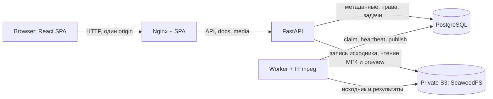

# Video-service: архитектура

Статус: архитектура принята на ревью как рабочая основа реализации. Отдельные технические решения могут уточняться по результатам тестов; существенный выход за принятую архитектуру согласуется отдельно. Требования, приоритеты, критерии приёмки и допущения A01–A12 приведены в [requirements.md](requirements.md).

## 1. Решения и альтернативы

| Область | Выбор | Обоснование и границы |
| --- | --- | --- |
| Backend | Python 3.13, FastAPI, Pydantic 2, Uvicorn | Обязательный framework; валидация и OpenAPI. Одно приложение с модулями предметной области, один экземпляр API для демо. `/docs` и `/openapi.json` доступны без SPA-fallback. |
| Данные | PostgreSQL 17, SQLAlchemy 2, psycopg 3, Alembic | Транзакции, FK, уникальные ограничения и миграции. Синхронный SQLAlchemy: обычные обработчики FastAPI работают в thread pool; блокирующий I/O из потоковых async-обработчиков выносится в ограниченный thread pool. |
| Frontend | React, TypeScript, Vite, React Router, обычный CSS | SPA без SSR: SEO не входит в ТЗ. Нативный `fetch` для JSON, `XMLHttpRequest` для прогресса загрузки, HTML5 `<video>` для MP4. Не вводить Redux и большой UI-kit без необходимости. Node.js 22 нужен только при сборке. |
| Медиа | SeaweedFS, S3 API через boto3, один контейнер `weed mini -dir=/data` | Закрытое объектное хранилище в single-node режиме; API хранения изолирован адаптером. Это принятая замена предпочтительному MinIO, причины ниже. |
| Обработка | Отдельный worker из того же backend-образа, FFprobe/FFmpeg | Не блокирует HTTP-процесс, использует ту же БД и модели. Это отдельный процесс модульного монолита, без собственного публичного API или отдельной схемы данных. |
| Очередь | Таблица `video_jobs` в PostgreSQL | Атомарная запись готового исходника и задания; один потребитель с lease/retry. Не требуется отдельный Redis/RabbitMQ/Celery. |
| Внешняя точка входа | Nginx со сборкой SPA | Один origin для интерфейса, API, `/docs` и media; простые cookie и отсутствие прямого доступа браузера к S3. Nginx также ограничивает запросы и проксирует потоковую передачу. |
| Развёртывание | Docker Compose, один Ubuntu-хост | Согласуется с требованием сдачи; сохраняемые volumes, healthchecks и одноразовые миграции. Kubernetes и микросервисы не нужны. |

Версии React/Vite/FastAPI и конкретные patch-версии остальных компонентов закрепить в lock-файлах и образах на этапе реализации после проверки совместимости. Не использовать плавающий `latest` в сдаваемой конфигурации. Здесь не утверждается, что выбранные версии уже собраны или протестированы совместно.

### Почему выбран SeaweedFS вместо MinIO

На дату проектирования 14 ноября 2026 года официальный репозиторий MinIO помечен как архивированный с 25 апреля 2026 года, README сообщает об отсутствии сопровождения и распространении Community Edition только в исходном виде. Это создаёт дополнительную работу по сборке и сопровождению хранилища в коротком проекте. Основание: [официальный репозиторий MinIO](https://github.com/minio/minio).

SeaweedFS предлагает single-node S3-хранилище через `weed mini` и Docker-образ; для нашего масштаба выбирается только этот режим, без отдельного развёртывания master/filer/volume. Основание: [официальный README SeaweedFS](https://github.com/seaweedfs/seaweedfs) и [quick start](https://github.com/seaweedfs/seaweedfs/wiki/Quick-Start-with-weed-mini). Отсюда инженерный вывод: вариант сокращает подготовку окружения по сравнению с самостоятельной сборкой несопровождаемого MinIO. Это не утверждение о промышленной надёжности без испытаний.

Критический нюанс: SeaweedFS без настроенных credentials допускает анонимные операции. С самого старта обязательны S3 credentials, отсутствие публичных ACL и проверка отказа анонимному клиенту; иначе окружение считается неготовым. См. [официальные правила S3 credentials](https://github.com/seaweedfs/seaweedfs/wiki/S3-Credentials). Подмена SeaweedFS на MinIO при явном требовании пользователя возможна через S3-адаптер, но потребует отдельно согласованного источника образа и проверки безопасности. Локальный каталог вместо объектного хранилища не удовлетворяет D01–D04.

## 2. Компоненты и границы



Браузер не обращается к PostgreSQL, worker, S3 и административным интерфейсам. API и worker разделяют бизнес-модель и адаптеры, но не память, `Session` и локальные временные файлы. Общие долговечные данные — PostgreSQL и S3; Redis, общая папка с опубликованными MP4 и публичный bucket отсутствуют.

Внутри backend: `router` принимает HTTP и сериализует данные → `service` проверяет бизнес-правила и управляет транзакцией → `repository` обращается к БД. Политики доступа находятся в одном модуле `access`, переиспользуются API метаданных, списками и media. S3 и запуск FFmpeg — инфраструктурные адаптеры, а не логика router.

Операция записи имеет явную короткую транзакцию на уровне service. Repository не делает скрытый `commit`. HTTP-передача, S3 и FFmpeg выполняются без долгой открытой SQL-транзакции. Каждому запросу/итерации worker — собственная `Session`, она не разделяется между потоками. Основание: [SQLAlchemy: управление Session и транзакциями](https://docs.sqlalchemy.org/en/20/orm/session_basics.html).

## 3. Планируемая структура каталогов

Это схема будущей реализации; каталоги и файлы ниже сейчас не создаются.

```text
backend/
  app/
    main.py
    core/                 # settings, auth/session, ошибки, logging
    db/                   # engine, base, управление Session
    modules/
      auth/               # router, schemas, service, repository, models
      channels/
      videos/
      access/             # единые политики чтения и владения
      interactions/       # likes, comments, subscriptions
      playlists/
      moderation/         # reports, скрытие, роли, журнал
    infrastructure/
      storage.py          # S3 adapter: head/get/upload/delete-temp
      transcoder.py       # FFprobe/FFmpeg без shell
    worker/
      main.py             # polling, heartbeat, восстановление, cleanup
      jobs.py             # обработка video_jobs
    cli/                  # seed, создание первого admin
  migrations/             # Alembic
  tests/
    unit/
    integration/
frontend/
  src/
    app/                  # routing, session provider, layout
    pages/                # feed, watch, channel, search, upload, auth, studio,
                          # playlists, subscriptions, moderation, admin
    features/             # формы и действия по предметным областям
    components/           # карточки, player, pagination, error/loading
    api/                  # типизированный HTTP client, обработка ошибок
    styles/
  tests/
tests/e2e/                # Playwright: пользовательские сценарии
infra/                    # Dockerfiles, Nginx, конфигурация S3
scripts/                  # deploy, smoke, backup/restore
compose.yaml
README.md
docs/
```

Общая бизнес-логика не копируется в worker и CLI. Не вводить абстрактный универсальный repository или event bus: достаточно конкретных service/repository по модулям. Тесты, инфраструктура, README и lock-файлы появятся отдельными задачами после ревью.

## 4. Модель данных

Основные сущности используют `uuid` PK, время — `timestamptz` в UTC; связи ниже — настоящие FK. Исключения для составных PK указаны явно. Поля состояний — `text` с `CHECK`, чтобы изменение набора состояний не требовало сложной миграции PostgreSQL enum. Секреты и бинарное содержимое медиа не хранятся в прикладных JSON-полях.

| Таблица | Основные поля | Связи и ограничения |
| --- | --- | --- |
| `users` | `id`, `email`, `username`, `password_hash`, `role`, `created_at`, `updated_at` | Нормализованные `email` и `username` — отдельные `UNIQUE`; `role IN (user, moderator, admin)`. Публичные ответы не содержат email и password hash. |
| `sessions` | `id`, `user_id`, `token_hash`, `csrf_token`, `expires_at`, `created_at` | FK → users; `token_hash UNIQUE`, индекс `expires_at`. Случайный session token хранится только у клиента; CSRF-токен сам по себе не авторизует. Выход удаляет сессию. |
| `channels` | `id`, `user_id`, `title`, `description`, `created_at`, `updated_at` | `user_id UNIQUE` FK → users, один канал на пользователя. Публичный адрес использует `users.username`; отдельный дублирующий handle не нужен. |
| `videos` | `id`, `channel_id`, `title`, `description`, `visibility`, `status`, `moderation_state`, `duration_ms`, `width`, `height`, `published_at`, `upload_token`, `upload_expires_at`, `error_stage`, `error_code`, `created_at`, `updated_at` | FK → channels; владелец определяется через `channels.user_id`. `visibility IN (public, private)`; статусы ниже. `moderation_state IN (visible, hidden)` независим от обработки; клиент не может задавать его. Nullable media-параметры до проверки файла. |
| `video_access` | `video_id`, `user_id`, `granted_by`, `created_at` | PK `(video_id, user_id)`; FK → videos/users. Выдать/отозвать может только владелец; self-grant не нужен. |
| `video_assets` | `id`, `video_id`, `kind`, `object_key`, `content_type`, `size_bytes`, `sha256`, `created_at` | FK → videos; `UNIQUE(video_id, kind)`, `object_key UNIQUE`; `kind IN (source, playback, thumbnail)`, размер > 0. Строки playback/thumbnail появляются только при успешной публикации. Bucket задаётся конфигурацией, не клиентом. |
| `video_jobs` | `id`, `video_id`, `status`, `attempts`, `run_after`, `lease_token`, `lease_expires_at`, `heartbeat_at`, `last_error_code`, `created_at`, `updated_at` | `video_id UNIQUE` FK → videos; одна задача обработки на видео, её попытки обновляют ту же запись. `status IN (queued, running, succeeded, failed)`, `attempts` 0–3. |
| `likes` | `video_id`, `user_id`, `created_at` | PK `(video_id, user_id)`; FK → videos/users. Идемпотентные PUT/DELETE. |
| `comments` | `id`, `video_id`, `user_id`, `body`, `created_at` | FK → videos/users; ограничение длины body. Индекс `(video_id, created_at, id)`. |
| `subscriptions` | `user_id`, `channel_id`, `created_at` | PK `(user_id, channel_id)`; FK → users/channels. Запрет подписки на собственный канал проверяет service. |
| `playlists` | `id`, `channel_id`, `title`, `description`, `created_at`, `updated_at` | FK → channels. Все плейлисты первой версии публичные, право редактирования следует из канала. |
| `playlist_items` | `playlist_id`, `video_id`, `position`, `created_at` | PK `(playlist_id, video_id)`; FK → playlists/videos; `UNIQUE(playlist_id, position) DEFERRABLE INITIALLY DEFERRED`, position ≥ 0. Перестановка — в одной транзакции с блокировкой плейлиста. |
| `reports` | `id`, `video_id`, `reporter_id`, `reason`, `body`, `status`, `reviewed_by`, `review_note`, `resolved_action_id`, `created_at`, `reviewed_at` | FK → videos/users/moderation_actions; `UNIQUE(video_id, reporter_id)`; `status IN (open, dismissed, actioned)`. Проверка права видеть ролик при создании жалобы. |
| `moderation_actions` | `id`, `actor_id`, `video_id`, `target_user_id`, `action`, `previous_value`, `new_value`, `reason`, `created_at` | FK → users/videos; ровно одна цель: video или user, `CHECK`. Действия `hide`, `restore`, `set_role`; добавление вместе с изменением в одной транзакции, без API редактирования/удаления журнала. |

Итого 14 основных таблиц и одна служебная. Учёт факта работы единственного worker — heartbeat-запись с фиксированным ключом в таблице `worker_heartbeats(worker_id PK, last_seen_at)`: она нужна для readiness даже при пустой очереди. Это эксплуатационная таблица, не новая предметная сущность.

Дополнительные индексы: частичный `(published_at DESC, id DESC)` для `videos` с `public/ready/visible`; `(channel_id, created_at DESC, id DESC)`; обратные FK-индексы для `video_access.user_id`, `playlist_items.video_id`, `subscriptions.channel_id`; очередь `(status, run_after, created_at)`; жалобы `(status, created_at)`. Счётчики лайков/комментариев считаются агрегатами с индексами, отдельные дублирующие счётчики пока не нужны. Не выполнять N+1 запрос на каждую карточку.

Поиск: параметризованный `ILIKE` по названию с экранированием `%`, `_` и escape-символа, только среди публичных готовых видимых видео. Для начального объёма допустим последовательный просмотр; `pg_trgm` + GIN добавлять только при подтверждённой измерениями необходимости; N03 остаётся дополнительным ориентиром, не обязательным критерием сдачи. PostgreSQL разворачивается в UTF-8 с Unicode-aware locale; регистронезависимость кириллицы проверяется отдельно.

Списки используют keyset cursor по `(published_at, id)` для видео, `(created_at, id)` для комментариев; `limit=20`, максимум 100. Cursor валидируется, не содержит приватных данных. Удаление предметных сущностей не входит в первую версию; FK по умолчанию запрещают случайное удаление, каскады допустимы лишь для элементов явно удаляемого плейлиста. Миграции применяются Alembic, `create_all` не заменяет их.

## 5. Аутентификация и авторизация

### Сессии

Используются серверные сессии вместо JWT: в проекте один backend, а выход и проверка актуальной роли должны действовать сразу. После входа генерируется криптографически случайный токен минимум 256 бит, в БД хранится SHA-256 токена; это хеш высокоэнтропийного токена, а не замена Argon2id для паролей. Cookie `session_id`: `HttpOnly`, `SameSite=Lax`, `Path=/`, без `Domain`, `Secure` в HTTPS. Срок 7 суток; роль читается из users, не из cookie.

Пароли 12–128 символов, хеш Argon2id через поддерживаемую библиотеку; параметры и ресурсы проверить на целевом стенде. API не обрезает пароль молча. Вход/регистрация ограничены Nginx: предложенные пределы 5 и 3 запроса/минуту на IP с небольшим burst; общий proxy не считается доверенным источником IP без явной конфигурации.

Вход возвращает пользователя и CSRF-токен; после обновления страницы `GET /api/auth/session` возвращает их для действующей cookie. CSRF-токен связан с сессией и передаётся в `X-CSRF-Token` на изменяющих запросах, включая загрузку файла. Все изменения требуют совпадения `Origin` с `APP_ORIGIN`; вход/регистрация дополнительно принимают только JSON, также проверяют `Origin`. Отсутствующий/чужой Origin — `403`; CLI должен послать его явно. Сессия создаётся заново при каждом входе, при выходе удаляется. Ответы сессии не кешируются. `/docs` использует тот же origin и может вызвать вход/получение CSRF через API; OpenAPI описывает cookie-схему и требуемый заголовок, не обещает встроенный JWT OAuth flow.

Основание защитных мер: [OWASP Session Management](https://cheatsheetseries.owasp.org/cheatsheets/Session_Management_Cheat_Sheet.html) и [OWASP CSRF Prevention](https://cheatsheetseries.owasp.org/cheatsheets/Cross-Site_Request_Forgery_Prevention_Cheat_Sheet.html). Режим HTTP допустим только для loopback-демо, в котором `Secure` явно отключён; смена на публичный origin без HTTPS должна завершать конфигурационную проверку ошибкой.

### Единая политика видео

`can_watch(user, video)` истинна, только если одновременно:

1. `status == ready` и `moderation_state == visible`;
2. `visibility == public`, либо пользователь — владелец канала, либо существует его строка в `video_access`.

Роли не добавляют условие обхода приватности. Для гостя допустим только public. Эту политику применяют к метаданным watch-страницы, MP4, preview, чтению/записи комментариев и лайков. Для изменений дополнительно нужна действующая сессия. Публичные feed/search/channel показывают только public; плейлисты фильтруются через `can_watch`, порядок и количество вычисляются после фильтрации без раскрытия пропусков.

Владелец видит статусы всех своих видео через отдельный studio API, включая private/failed/hidden, и управляет метаданными/разрешениями. Это не разрешение воспроизводить скрытый модератором ролик. Публикация worker не меняет visibility или moderation_state. Удалённый grant начинает запрещать следующий запрос после commit; API не кеширует решения доступа.

| Действие | Гость | Пользователь | Модератор | Администратор |
| --- | --- | --- | --- | --- |
| Смотреть public/ready/visible | Да | Да | Да | Да |
| Смотреть private/ready/visible | Нет | Владелец или grant | Владелец или grant | Владелец или grant |
| Загрузка, свой канал, плейлисты | Нет | Свои объекты | Свои объекты | Свои объекты |
| Менять метаданные/grants видео | Нет | Только владелец | Только владелец | Только владелец |
| Жаловаться, комментировать, ставить лайк | Нет | При `can_watch` | При `can_watch` | При `can_watch` |
| Разбирать жалобы, скрывать/восстанавливать | Нет | Нет | Да | Да |
| Назначать `user`/`moderator` | Нет | Нет | Нет | Да, кроме изменения admin |

Модератор/администратор для приватного ролика без grant видит только служебную карточку жалобы: ID видео, ID владельца, причина/текст заявителя, состояние и история решений. Название, описание, превью и медиа не выдаются. Жалоба не выдаёт grant автоматически; содержимое можно увидеть только после разрешения владельца. Понижение/создание admin через публичный API запрещено; bootstrap admin — CLI, при повторном запуске не перезаписывает существующего пользователя. Изменение роли и аудит выполняются атомарно.

## 6. Контракт API и экранов

Префикс бизнес-API — `/api`, версия контракта фиксируется вместе с OpenAPI. Маршруты ниже — планируемый минимальный контракт, не существующие endpoints. Ответ ошибки: `{code, message, request_id}`; без SQL, tracebacks и секретов. Для неавторизованной операции аккаунта — `401`, отсутствующего/недоступного видео — `404`, нарушения роли — `403`, конфликтующего состояния — `409`, размера — `413`, валидации — `422`, перегрузки — `429`, временной недоступности зависимости — `503`.

| Группа | Маршруты |
| --- | --- |
| Auth | `POST /auth/register`, `POST /auth/login`, `POST /auth/logout`, `GET /auth/session` |
| Видео | `GET /videos?q=&cursor=&limit=`, `GET /videos/{id}`, `POST /videos` (черновик), `PUT /videos/{id}/source` (raw body), `PATCH /videos/{id}` (метаданные/visibility, только owner) |
| Studio | `GET /me/videos`, `GET /me/videos/{id}` — статусы, ошибки, метаданные своих видео |
| Media | `GET/HEAD /videos/{id}/media`, `GET/HEAD /videos/{id}/thumbnail` |
| Grants | `GET /videos/{id}/access`, `PUT /videos/{id}/access/{username}`, `DELETE /videos/{id}/access/{username}` — только owner |
| Реакции | `PUT/DELETE /videos/{id}/like`, `GET/POST /videos/{id}/comments` |
| Каналы | `GET /channels/{username}`, `PATCH /me/channel`, `GET /channels/{username}/videos`, `GET /channels/{username}/playlists` |
| Подписки | `PUT/DELETE /channels/{username}/subscription`, `GET /me/subscriptions` |
| Плейлисты | `POST /playlists`, `GET/PATCH/DELETE /playlists/{id}`, `PUT/DELETE /playlists/{id}/items/{video_id}`, `PUT /playlists/{id}/order` (полный список ID) |
| Модерация | `POST /videos/{id}/reports`, `GET /moderation/reports`, `PATCH /moderation/reports/{id}` (решение), `PUT /moderation/videos/{id}/state` (`hidden`/`visible`, reason), `GET /moderation/actions` |
| Роли | `GET /admin/users?username=` (поиск пользователя), `PUT /admin/users/{id}/role` — только `user`/`moderator`, действующего admin изменять нельзя |

Все пути таблицы относительны `/api`. Модераторские endpoints не используют обычный watch API для доступа к служебным карточкам. Скрытие, запись действия и перевод выбранной жалобы в `actioned` — одна транзакция; отклонение жалобы сохраняет reviewer/note, не меняет видео. Повторный лайк/grant/подписка идемпотентен благодаря уникальным ключам и `ON CONFLICT`; редактирование плейлиста сериализуется блокировкой его строки. Добавлять можно только собственные видео; запрос перестановки должен содержать ровно текущий набор элементов без повторов, а не произвольные новые ID.

SPA: `/`, `/watch/:id`, `/results?q=`, `/channels/:username`, `/playlists/:id`, `/subscriptions`, `/upload`, `/studio`, `/login`, `/register`, `/moderation`, `/admin`. На форме загрузки: файл, title, description, visibility, username получателей для private; фактические grants оформляются API после создания черновика. Верхняя строка поиска, sidebar и карточки общие. Владельцу доступна ссылка на ролик для передачи получателю. Для всех сетевых действий предусмотрены loading/empty/error; переход по private URL не загружает metadata до серверной проверки. Визуальная проверка по F13 дополняет E2E.

## 7. Жизненный цикл видео

### Состояния

`awaiting_upload → uploading → queued → processing → ready`.

Сбой при отправке: `uploading → failed`, `error_stage=upload`. Владелец может повторить отправку в этот же черновик, если исходник ещё не принят. Сбой обработки: `processing → queued` для временной ошибки с оставшимися попытками либо `processing → failed`, `error_stage=processing`. Принятый исходник неизменяемый: повторный `PUT source` при наличии source asset возвращает `409`, в том числе после ошибки обработки. При потерянном ответе UI сначала читает studio status и не создаёт вторую загрузку для queued/processing/ready.

`visibility` и `moderation_state` — независимые оси, не дополнительные состояния обработки. `published_at` выставляется один раз при первом ready; изменение видимости не поднимает ролик в ленте.

### Приём исходника

1. `POST /api/videos` создаёт черновик с серверным владельцем, метаданными и visibility (по умолчанию private). Возвращает `video_id`; при необходимости владелец выдаёт grants. Публично черновик не виден.
2. Браузер отправляет `File` как `application/octet-stream` через XHR на `PUT source`, с cookie и CSRF. `upload.onprogress` показывает долю отправленного тела. Nginx отключает request buffering для этого пути, ставит лимит 500 MiB и таймауты; сервер повторно считает фактические байты.
3. До чтения тела API проверяет owner, CSRF, состояние и лимиты параллелизма. В короткой транзакции берёт блокировку строки пользователя и видео, резервирует загрузку: `status=uploading`, случайный `upload_token`, `upload_expires_at=now()+15 min`. Два параллельных запроса к одному видео не выигрывают одновременно. Общий предел две загрузки обеспечивается семафором единственного API-процесса; пользовательский предел — запросом по активным загрузкам под блокировкой users.
4. API читает `Request.stream()` порциями не больше 1 MiB, пишет в собственный scratch, вычисляет SHA-256. Блокирующие файловые операции/S3-вызовы не выполняются в event loop. Таймаут всей загрузки 15 минут, счётчик байтов работает независимо от заголовков. Путь генерируется сервером из UUID, исходное имя используется только как безопасный текст, не как путь или ключ. Перед резервированием проверяется свободное место, минимум 2 GiB в scratch.
5. Законченный локальный файл загружается boto3 в `sources/{video_id}/{upload_token}/original` закрытого bucket `video-media`. SDK может использовать S3 multipart; это внутренний механизм, browser resumable upload не реализуется. После upload выполняется `HEAD`, сравнивается размер; сохраняется вычисленный SHA-256. Недоступность S3 не переводит видео в queued.
6. В одной SQL-транзакции при всё ещё действующем `upload_token` и неистёкшем сроке создаются source asset и `video_jobs(status=queued)`, видео становится queued, reservation очищается. Затем API отвечает `202`. Уникальные ключи исключают две задачи; исходник после этой точки immutable.
7. Локальный scratch очищается в `finally`. При обрыве/ошибке reservation переводится в failed только владельцем действующего token. Если клиент потерял ответ после commit, чтение studio status обнаружит queued, повторять файл не нужно.

При падении между S3 и commit остаётся объект без записи, который позже удалит cleanup. При падении до S3 истёкшая reservation становится failed и допускает новый upload с новым token. Старый процесс после истечения срока уже не имеет права commit; оставшийся объект не используется. Временные объекты и неполные multipart uploads старше 24 часов удаляются только после проверки отсутствия ссылок в БД и активного token. Действительные source assets автоматически не удаляются.

### Worker и обработка

1. Worker опрашивает PostgreSQL раз в 2 секунды. В короткой транзакции выбирает одну готовую к запуску задачу через `FOR UPDATE SKIP LOCKED`, увеличивает attempts, создаёт `lease_token`, ставит running и переводит видео в processing. Транзакция закрывается до скачивания/FFmpeg. Такой способ подходит очередям: [PostgreSQL, SELECT / SKIP LOCKED](https://www.postgresql.org/docs/17/sql-select.html).
2. Worker скачивает source в собственный scratch, сверяет размер/SHA-256, запускает `ffprobe` с таймаутом 30 секунд. Проверяет контейнер, наличие видеопотока, длительность, размеры/поворот и fps против V01/V02. Неподдерживаемый/повреждённый файл — terminal failure, а не бесконечные retries.
3. FFmpeg создаёт MP4: первый видеопоток, первая аудиодорожка при наличии, без субтитров/attachments; `libx264`, `preset=veryfast`, `crf=23`, `maxrate=2500k`, `bufsize=5000k`, `yuv420p`, не больше 30 fps; AAC 128 kbit/s, stereo. Изображение вписывается в 1280×720 с сохранением пропорций, чётными размерами, без upscale, с учётом rotation. Метаданные исходника удаляются; `movflags=+faststart` переносит индекс MP4 в начало для старта без скачивания целого файла. Основание последнего: [FFmpeg Formats](https://ffmpeg.org/ffmpeg-formats.html).
4. Создаётся JPEG-превью максимум 640×360 из кадра на `min(1 s, duration/2)`. Отсутствие аудио допустимо. MP4 повторно проверяется `ffprobe`, превью — на существование/ненулевой размер. Нулевые, оборванные результаты не публикуются.
5. FFmpeg имеет общий таймаут 20 минут и максимум два CPU threads, worker — лимит 2 CPU / 2 GiB RAM, один subprocess обработки. Перед запуском проверяется scratch; на задачу резервируется до 2 GiB. Исполнение без shell, только локальный вход, allowlist демультиплексоров и протоколов `file,pipe`, без сетевых ссылок. Scratch отдельный, контейнер non-root, без privileged/docker socket/host mounts; секреты не передаются в аргументах или окружении FFmpeg. Разрешение file не считается защитой от чтения произвольных файлов: принимаются только проверенные самостоятельные контейнеры MP4/MOV/Matroska/WebM, плейлисты не допускаются.
6. Результаты пишутся под новыми ключами `processed/{video_id}/{lease_token}/playback.mp4` и `.../thumbnail.jpg`. После проверки объектов в одной транзакции с блокировкой job и проверкой действующего lease записываются playback/thumbnail assets, параметры видео, ready/published_at и job succeeded. Изменять visibility/moderation_state этой транзакции запрещено.
7. Если lease утрачен, попытка не публикует результат и завершает subprocess. Её ключи не совпадают с ключами новой попытки, поэтому она не перезапишет действительный MP4. Scratch очищается после успеха/ошибки; объекты неуспешных попыток удаляются безопасным cleanup после срока хранения.

### Lease, retries и восстановление

Worker обновляет lease каждые 15 секунд, срок lease — 60 секунд; heartbeat выполняется независимо от ожидания subprocess. Продление и публикация требуют совпадения token и неистёкшего lease. При потере БД/lease worker останавливает subprocess и прекращает запись результата. Общий heartbeat worker сохраняется в `worker_heartbeats` каждые 15 секунд, в том числе на пустой очереди.

Просроченный running job при следующем проходе recovery возвращается в queued, если attempts < 3, иначе job и video становятся failed. Временные ошибки S3/БД/сети повторяются с задержками 10 и 60 секунд, максимум три запуска суммарно. Некорректный формат/лимиты/невозможность декодирования — сразу failed. Для потерянного commit worker перечитывает запись: succeeded не запускается повторно. Атомарность между S3 и БД заменяется неизменяемыми ключами, проверкой lease и уборкой сирот, распределённая транзакция не вводится.

Cleanup запускается тем же worker периодически, не отдельным сервисом: истёкшие upload reservations, собственный устаревший scratch и объекты без ссылок старше 24 часов. API очищает свой отдельный scratch при запуске и перед загрузками: только файлы старше 24 часов без активного upload token. Worker не монтирует каталог API. Очистку очереди/файлов нельзя выполнять при недоступной БД, иначе невозможно доказать отсутствие действующей ссылки. Автоочистка ограничена техническими временными артефактами, не пользовательскими видео.

Эксплуатационный инвариант текущей конфигурации: один контейнер worker и один основной поток, который сначала завершает `run_once()` (включая публикацию), затем синхронно вызывает S3 cleanup. Фоновые потоки выполняют только heartbeat; API вызывает только очистку собственного отдельного scratch volume. Внешнего CLI/планировщика S3 cleanup нет. Обычный restart/recreate прекращает старый процесс до запуска нового; recovery выполняется в том же последовательном цикле. Нельзя запускать дополнительный worker, `--scale worker=2` или отдельный S3 cleanup без отдельного согласования координации: проверка отсутствия ссылки и удаление S3-объекта не образуют атомарной операции с публикацией.

`FastAPI.BackgroundTasks` не используется для транскодирования: задача должна переживать HTTP-процесс и сохранять попытки. Документация FastAPI отдельно отмечает необходимость других механизмов для тяжёлых вычислений: [Background Tasks](https://fastapi.tiangolo.com/tutorial/background-tasks/). Наш выбор PostgreSQL-очереди обусловлен малым масштабом, а не требованием FastAPI использовать конкретный брокер.

### Воспроизведение и отзыв доступа

HTML5 player получает same-origin URL `/api/videos/{id}/media`, preview — `/thumbnail`. URL содержит только ID видео, не ключ хранилища и не bearer token. Для каждого GET/HEAD API читает текущую сессию/роль, video state и grant из PostgreSQL, затем получает asset. Доступ к source endpoint для чтения отсутствует.

Для GET API проверяет byte range, передаёт одиночный Range в S3 `GetObject`, выдаёт поток порциями максимум 256 KiB с backpressure. Для HEAD достаточно метаданных asset/проверки доступности объекта, тело не читается; Range игнорируется, размер соответствует полному объекту, авторизация остаётся обязательной. Поддерживаются `bytes=start-end`, `bytes=start-` и suffix range, границы ограничиваются размером; некорректные/множественные/неудовлетворимые GET ranges возвращают `416` с `Content-Range: bytes */size`. Если нет Range — `200`; корректный GET-диапазон — `206`. MP4 имеет `video/mp4`, превью `image/jpeg`, включён `X-Content-Type-Options: nosniff`. Семантика Range/HEAD: [RFC 9110, раздел 14.2](https://www.rfc-editor.org/rfc/rfc9110.html#section-14.2).

S3-ответ закрывается при отмене запроса, полный объект не буферизуется. SQL-транзакция и соединение с БД освобождаются до передачи тела. Nginx отключает response buffering и proxy cache для media; чувствительные ответы имеют `Cache-Control: private, no-store`, SPA/service worker не кеширует их. S3 redirect, публичные ACL и presigned GET не используются.

После отзыва grant, public → private, скрытия или logout новый Range/GET/HEAD со старым URL отклоняется. Уже начатый ответ может завершиться, а уже скачанные байты или запись экрана отозвать нельзя; активное принудительное прерывание всех потоков и DRM вне первой версии. Это явно принятая граница A02/S04, не обещание абсолютной защиты от копирования.

## 8. Compose и одна команда на Ubuntu

| Service | Назначение и готовность | Данные / сеть |
| --- | --- | --- |
| `web` | Nginx + собранный frontend, единственный внешний вход; доступен после API readiness | По умолчанию `127.0.0.1:8080`; `/api`, `/docs`, `/openapi.json`, `/health/*` проксируются до SPA fallback. |
| `api` | Uvicorn, один процесс; `/health/live` и `/health/ready` | Только внутренняя сеть, отдельный scratch volume для загрузок; не монтировать весь репозиторий в сдаваемый контейнер. |
| `worker` | Тот же образ, другой entrypoint; очередь + FFmpeg + cleanup | Внутренняя сеть, отдельный scratch volume; heartbeat, CPU/RAM limits, restart policy. |
| `db` | PostgreSQL; `pg_isready`, затем проверка реального запроса | Volume `postgres_data`; порт на хост не публикуется. |
| `storage` | SeaweedFS mini с обязательной аутентификацией S3 | Volume `media_data` на весь `/data`, включая собственные метаданные filer; host ports отсутствуют. |
| `storage-init` | Одноразово создаёт закрытый bucket, проверяет credentials и анонимный отказ | Внутренний S3, ненулевой exit при небезопасной конфигурации. |
| `migrate` | Одноразово выполняет `alembic upgrade head` | Ждёт healthy db, использует тот же backend-образ. |
| `seed` | Одноразовый сервис в demo profile, создаёт данные и enqueue задач через сервисный слой | После migrate/storage-init; действительный pipeline, не фальшивые ready-записи. |

Одноразовые migrate/storage-init/seed не становятся постоянно работающими микросервисами. API и worker ждут успешных migrate/storage-init, worker также healthy db/storage. API startup не зависит от heartbeat worker, чтобы избежать цикла; внешняя readiness и deploy проверяют worker после его запуска. `web` запускается после healthy API. Compose различает запуск контейнера и готовность; использовать `service_healthy` и `service_completed_successfully`: [Docker Compose startup order](https://docs.docker.com/compose/how-tos/startup-order/).

Хранилище находится в отдельной внутренней Docker-сети, доступной только api/worker/init/seed; служебные интерфейсы SeaweedFS не доступны браузеру или Nginx. Не задавать публичные ACL. Стартовые S3 credentials ограничены окружением; доступ приложения — к bucket `video-media`. Управляющие credentials используются init и конфигурацией самого хранилища, но не передаются API/worker. Корректность разрешений и недоступность anonymous обязательно проверяет интеграционный тест на выбранном закреплённом образе, а не только текст конфигурации.

Будущий `sudo bash scripts/deploy.sh --demo` выполняет:

1. Проверяет Ubuntu 24.04 LTS amd64, sudo, интернет, место на диске и порт. Если Docker отсутствует, устанавливает Engine и Compose plugin из официального apt-репозитория по [инструкции Docker для Ubuntu](https://docs.docker.com/engine/install/ubuntu/). Конфликтующие установленные пакеты не удаляет без решения пользователя. Внешние install-скрипты через `curl | sh` не выполняет.
2. При первом запуске создаёт локальную конфигурацию и криптографически случайные секреты с правами `0600`; повторно не меняет их. Конфигурация исключается из Git/build context, шаблоны содержат только имена параметров. Не печатает пароль/полный `docker compose config` в журнал.
3. Собирает закреплённые образы приложения/SPA, поднимает db/storage и выполняет migrate/storage-init с проверкой exit codes. Запускает API и worker; проверяет зависимости и heartbeat, затем web. Ожидание ограничено таймаутом и возвращает ненулевой exit при ошибке.
4. Для `--demo` запускает идемпотентный seed: пять пользователей (`admin`, `moderator`, автор, получатель private grant, посторонний), два наполненных канала, шесть синтетических клипов по 5–10 секунд, включая private/hidden, социальные данные и жалобы. Seed вызывает сервисы создания и ставит видео в обычную очередь; после обработки добавляет финальные связи. Существующие записи узнаёт по фиксированным demo IDs/username, не перезаписывает их данные и пароли. Сбой посередине допускает продолжение повторным запуском.
5. Ждёт завершения демонстрационных задач с общим лимитом 10 минут, проверяет ожидаемые состояния, frontend, `/docs`, `/openapi.json`, readiness. Выводит URL, статус и путь к защищённому файлу демо-учётных данных; значения паролей не пишет в логи. Демо-файл не включается в сдаваемый Git-архив.

По умолчанию приложение доступно как `http://localhost:8080`. Для удалённого сервера используется SSH-туннель с тем же localhost origin. Публичный HTTPS-origin, домен и сертификаты требуют конфигурации Nginx/TLS и `Secure` cookie; автоматическое получение домена/сертификата не подразумевается. Не менять firewall и не открывать DB/S3-порты как часть запуска.

`/health/live` подтверждает жизнь API; `/health/ready` возвращает `200` только после migrate, проверки БД, авторизованного S3-доступа и heartbeat worker не старше 45 секунд, иначе `503`. Собственная liveness worker опирается на heartbeat loop, а не на существование PID. Выключение/перезапуск без `-v` сохраняет volumes; восстановление из backup требует остановить writers и восстановить PostgreSQL вместе со всем `/data` хранилища, после чего проверить leases и объекты. Ни deploy, ни seed не выполняют `down -v`, destructive migrations или сброс данных автоматически.

## 9. Проверки и порядок реализации

Проверки выполняются по мере реализации. Базовый каркас запускает API, frontend, БД и S3 без worker и предметных функций. Его `/health/ready` проверяет только текущие зависимости (БД, миграции и S3); проверка heartbeat добавляется вместе с worker. Полный набор проверок:

- pytest: unit для политик/состояний/range; интеграционные тесты с настоящими PostgreSQL и выбранным S3, включая атомарность задания, grants, ограничения ролей, скрытие и retries. SQLite и S3-mock не заменяют эти интеграции.
- FFmpeg smoke: короткие синтетические MP4/WebM, клип без аудио, повреждённый и превышающий лимиты вход; контроль готового файла через FFprobe и браузерное воспроизведение.
- Playwright: критический путь T02; приватность и модерация дополняются проверками API/media T03/T05. Для browser E2E выбрать сборку Chromium с поддержкой H.264 и проверить фактическое продвижение `currentTime`, а не только наличие `<video>`.
- Ruff, frontend ESLint, TypeScript typecheck и production build; `docker compose config --quiet`, миграции на пустой БД, повторный seed, restart и smoke. Проверку чистой Ubuntu T08 проводить на отдельной VM, не выдавать локальный Compose за её замену.
- Проверка артефактов: секреты, private assets, оригинальные AI-журналы и фактическая агентная обвязка; неизменность оригиналов, отдельное согласование публикации. При наличии секретов оригиналы передаются закрыто, производные копии не называются оригиналами.

Порядок реализации в принятой архитектуре: (1) skeleton/Compose/миграции/session; (2) upload → worker → media и private access; (3) feed/watch/лайк/комментарий + E2E; (4) каналы/плейлисты/подписки/поиск; (5) модерация/роли; (6) demo, визуальная доводка, чистая VM, документация и сдача. Безопасность и тесты добавляются с соответствующими задачами, не откладываются на последний шаг. Общий срок — 10 дней с момента получения; семь дней означали остаток времени на момент обсуждения (A01). Календарные даты не назначены без даты получения.

## 10. Риски и меры

| Риск | Мера и проверка |
| --- | --- |
| Прямой URL/preview/плейлист обходит private grant | Один `can_watch`, закрытый S3, отсутствие presigned URLs, no-store; матрица T03 для всех ролей и путей. |
| Модератор получает лишний доступ | Служебная карточка жалобы без медиа; роль не участвует в обходе grants; T05. Бизнес-трактовка A02 принята в рабочей архитектуре. |
| Смена/несопровождаемость хранилища | Обоснованная замена MinIO, S3-адаптер, закреплённый образ; до разработки UI проверить upload/head/range/private/restart на выбранном SeaweedFS. |
| Anonymous allow-all в SeaweedFS | Credentials с первого старта, отсутствие публичных ACL, закрытая сеть, негативный probe и T08. Не считать CORS политикой доступа. |
| API становится узким местом медиатрафика | Малый заявленный масштаб, потоковые буферы и лимиты; N03/T09. При росте сначала измерения, затем отдельное согласование proxy-auth/CDN, без тихой потери защиты private. |
| Две обработки/падение между БД и S3 | Короткие транзакции, unique job, lease fencing, отдельные attempt keys, отложенный cleanup, fault tests T07. |
| FFmpeg расходует ресурсы/обрабатывает опасный вход | Лимиты файла/длительности/кадра, allowlist, subprocess timeout, non-root, CPU/RAM/scratch bounds; T06. Контейнер не считается полной песочницей. |
| Переполненный диск и потеря данных | Лимиты параллелизма, контроль места, сохранённые volumes, очистка только сирот; backup/restore вместе с медиа. Автоматическое удаление пользовательского видео запрещено. |
| Сборка/стенд не воспроизводятся | Закрепление зависимостей/образов, миграции, идемпотентные deploy/seed, VM T08; не обещать успех до реального запуска. |
| Ограниченный срок 10 дней с момента получения | Сначала вертикальный P0, затем все P1; без HLS, брокера и микросервисов. О риске не успеть обязательное сообщать заранее, не переименовывать его в P2. |
| Оригинальные AI-журналы содержат секреты | Сохранять неизменными в защищённом месте, не включать в build context; отдельная проверка и закрытая передача, согласованная публикация производных копий. |

Выбранный стек и архитектурная основа приняты и повторного согласования не требуют. Лимиты и параметры можно уточнять по результатам тестов с фиксацией в документации. Полный функционал, worker и bootstrap чистой Ubuntu реализуются последующими задачами; фактическая готовность текущего каркаса описывается в README.
